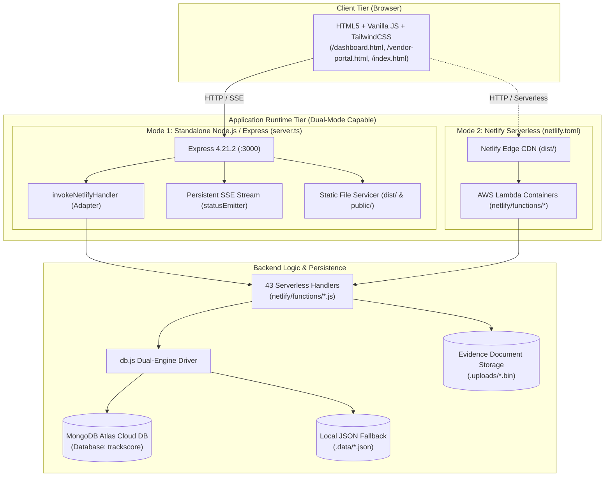

# TrackScore — Deployment Architecture Analysis & Options Report

**Document Version:** 1.0.0  
**Inspection Date:** 2026-09-27  
**Scope:** Architectural Evaluation, Netlify Dependency Audit, Express Self-Hosting Feasibility, and Deployment Decision Framework  
**Author:** Antigravity Autonomous Engineering & Architecture Auditor  

---

## 1. Executive Overview

This report provides an authoritative, evidence-based technical analysis of TrackScore’s deployment architecture options. 

The investigation examined whether TrackScore is strictly bound to the Netlify platform or whether it can run independently as a standard Node.js / Express application on a virtual private server (VPS), Docker container, or institutional university server.

### Key Finding
**TrackScore is NOT intrinsically dependent on Netlify.** 
Although the backend functions reside in `netlify/functions/` and follow the `(event, context)` AWS Lambda / Netlify signature, **the repository already contains a production-ready Express server (`server.ts`) with an automated bridge (`invokeNetlifyHandler`)**. 

Furthermore, **critical features of TrackScore—specifically real-time Server-Sent Events (SSE) and persistent document evidence storage (`.uploads/`)—actually operate significantly better and more reliably on a persistent Node.js / Express server than on Netlify's serverless platform**, which imposes ephemeral container filesystems and short execution timeouts.

---

## 2. Current Existing Architecture

The codebase currently implements a **hybrid dual-runtime architecture**:



### Detailed Component Breakdown

| Subsystem | Current Implementation | Observations |
| :--- | :--- | :--- |
| **Frontend Serving** | Static HTML5 / CSS3 / Vanilla JS bundled via Vite (`vite.config.ts`) into `dist/`. | Served by Express in production via `express.static(distDir)` or by Netlify CDN from `publish = "dist"`. |
| **Backend Execution** | Express server (`server.ts`) importing 43 ESM handlers from `netlify/functions/*.js`. | Handlers use standard `(event, context) => ({ statusCode, headers, body })` signatures. Express bridges them using `invokeNetlifyHandler()`. |
| **Database Connection** | `netlify/functions/db.js` connects via official `mongodb` npm driver (`v7.6.0`). | Primary: MongoDB Atlas cluster (`MONGODB_URI`). Fallback: pristine `.data/*.json` files on disk when Atlas is offline. |
| **File Storage** | Uploaded vendor documents (PDF, JPG, PNG) stored in `.uploads/<docId>.bin` on local disk. | Managed by `vendor-documents.js`. Files are referenced by metadata in MongoDB and strictly protected from public static access. |
| **Real-Time Communication** | Server-Sent Events (SSE) via `/api/status-stream`. | **Express implements persistent live streaming** using Node `EventEmitter` (`status-bus.js`) and 25s heartbeats. Netlify serverless can only return one-shot static responses. |
| **Authentication** | Stateless JWT bearer tokens (`auth.js`) using `jsonwebtoken` and `bcryptjs`. | Token contains `userId`, `role` (`manager`, `assessor`, `vendor`), and `linkedRegistrationIds`. Handled identically in Express and serverless. |
| **Certificate Generation** | Client-side DOM-to-PDF rendering (`html2pdf.js`) with authoritative backend signing metadata. | Completely independent of server infrastructure; requires no server-side Chromium or Puppeteer. |

---

## 3. Netlify Dependency Audit

An exhaustive repository scan was conducted to identify any proprietary Netlify code, packages, or configurations.

```text
Dependency Scan Result: 0 proprietary Netlify npm packages found.
No @netlify/functions, no @netlify/edge-functions, no Netlify Blobs, no Netlify Identity.
```

### Netlify Dependency Matrix

| Component | Netlify-Specific? | Can Run on Pure Node Server? | Technical Notes |
| :--- | :---: | :---: | :--- |
| `netlify/functions/*.js` | **NO** | **YES (Already does)** | Uses standard lambda signatures `(event, context)`. `server.ts` already mounts every file seamlessly. |
| `netlify.toml` | **YES** | **N/A** | Only used by Netlify CLI/build pipeline for edge redirects (`/api/*` -> `/.netlify/functions/:splat`). |
| API Route Names (`/.netlify/functions/*`) | **PARTIAL** | **YES** | `server.ts` already maps both `/.netlify/functions/<endpoint>` AND `/api/<endpoint>` aliases for complete compatibility. |
| Environment Variables (`process.env`) | **NO** | **YES** | Standard `dotenv` configuration. Reads from `.env` or system environment variables in any host. |
| Build Pipeline | **NO** | **YES** | `npm run build` runs `vite build && esbuild server.ts --bundle --outfile=dist/server.cjs`. Runs anywhere Node is installed. |
| Process Start Command | **NO** | **YES** | `npm start` executes `node dist/server.cjs`, listening on `0.0.0.0:3000`. Standard Linux/Windows service behavior. |

---

## 4. Can Express Run the Entire Application Standalone?

### **Verdict: YES, 100% OUT OF THE BOX.**

TrackScore can be started right now as a conventional Node.js / Express application without Netlify:

```bash
npm run build
npm start
```

When started with `node dist/server.cjs`:
1. **Frontend**: Express serves all production assets from `dist/` (or `public/`).
2. **APIs**: Express mounts all 35+ REST and management endpoints (`/api/login`, `/api/vendor-portal-data`, `/api/save-evaluation`, `/api/get-assessor-workload`, etc.).
3. **Database**: Connects directly to MongoDB Atlas via Node `mongodb` driver.
4. **SSE Streaming**: Express keeps long-lived HTTP sockets open with heartbeats, pushing real-time status updates instantly when records update.
5. **Document Storage**: Uploaded vendor files persist safely inside `.uploads/` on the server's filesystem.
6. **Rate Limiting**: In-memory sliding-window IP rate limiter operates accurately within the single running process.

---

## 5. Classification of Backend Function Files

All 43 files inside `netlify/functions/` were inspected and categorized:

| Category | Definition | File Count | Files Included |
| :---: | :--- | :---: | :--- |
| **Category A** | Pure business / engine logic or directly reusable API handler running via `invokeNetlifyHandler`. | **43** | **All 43 files in `netlify/functions/`** (including `db.js`, `auth.js`, `sla.js`, `assessment-risk.js`, `status-bus.js`, `rubric.js`, and all 36 API handlers). |
| **Category B** | Handlers requiring minor refactoring *only if* the team chooses to drop the `(event, context)` lambda adapter in favor of native Express `(req, res)` signatures. | *(36)* | Optional architectural cleanup; **not required** for operation since `invokeNetlifyHandler()` works flawlessly today. |
| **Category C** | Strongly depends on proprietary Netlify cloud runtime. | **0** | **None.** No Netlify APIs or vendor-locked SDKs are used. |

---

## 6. Comprehensive Deployment Options Analysis

### Option A — Netlify Cloud (Serverless JAMstack)

```text
Browser ──> Netlify CDN (dist/) ──> Netlify Serverless Functions (AWS Lambda) ──> MongoDB Atlas
```

* **How it Works**: The frontend is hosted on Netlify’s global CDN. Each API request spins up a temporary AWS Lambda container running a Netlify function.
* **Advantages**:
  * Zero server administration (no OS patches, no Linux systemd, no PM2).
  * Automated free SSL/TLS certificates and branch previews.
  * Automatic horizontal scaling with traffic spikes.
* **Severe Limitations for TrackScore**:
  1. **Ephemeral Filesystem (Document Upload Blocker)**: Netlify serverless functions have a read-only filesystem (with a temporary `/tmp` that is destroyed when containers cycle). Files written to `.uploads/` by `vendor-documents.js` **will be lost**. A vendor uploading a lab test or bank slip will find that subsequent requests to download it will return **HTTP 404**. To make Netlify viable, TrackScore would need to be rewritten to upload directly to Amazon S3, Google Cloud Storage, or Netlify Blobs.
  2. **Broken Persistent SSE**: Serverless lambdas have a maximum execution timeout (10s default, 26s max). Netlify functions buffer HTTP responses and cannot hold long-lived streaming connections open. Real-time push updates via `status-stream.js` will not function as a live stream; clients must fall back to short polling.
  3. **Fragmented In-Memory State**: `statusEmitter` and login rate-limiting `Map` instances are not shared across separate Lambda containers.
  4. **Data Sovereignty / Compliance**: Government or university policies may forbid hosting sensitive telematics assessments and vendor compliance data on US-based commercial cloud providers without institutional approval.

---

### Option B — Standalone Node.js / Express Server (Current Local / Direct Mode)

```text
Browser ──> Node.js + Express Server (:3000) ──> MongoDB Atlas
                 │
                 └──> Local Disk (.uploads/ & .data/)
```

* **How it Works**: The pre-built `dist/server.cjs` runs as a long-running daemon on any computer or server with Node.js installed.
* **Advantages**:
  * **Zero Code Changes Needed**: Works immediately with the current repository.
  * **Persistent Document Storage**: Files uploaded to `.uploads/` remain safely on local disk indefinitely.
  * **Fully Functional SSE**: `statusEmitter` maintains active streaming connections with heartbeats, notifying dashboards instantaneously.
  * **Accurate Rate Limiting**: The sliding-window IP rate limiter operates across all requests in memory.
  * **Dual-Database Resilience**: If MongoDB Atlas loses internet connectivity, the application seamlessly falls back to `.data/*.json` on the same disk.
* **Limitations**:
  * Requires a machine that stays powered on.
  * Does not include built-in SSL/HTTPS termination (must use reverse proxy or Cloudflare tunnel).

---

### Option C — Virtual Private Server (VPS) / Cloud VM (Recommended Cloud Architecture)

```text
Browser ──> Nginx (Port 443 / SSL / Reverse Proxy) ──> Express (:3000) ──> MongoDB Atlas
                                                            │
                                                            └──> Persistent SSD (.uploads/)
```

* **How it Works**: A Linux virtual machine (Ubuntu 24.04 LTS on AWS EC2, DigitalOcean, Linode, or Hetzner) running Nginx as a reverse proxy in front of Node.js managed by PM2.
* **Advantages**:
  * **Production Standard**: Standard enterprise setup for Node.js web applications.
  * **Free Automated SSL**: Let's Encrypt / Certbot automatically issues and renews HTTPS certificates.
  * **Process Reliability**: PM2 automatically restarts TrackScore if the process encounters an error or if the server reboots.
  * **Proper SSE Handling**: Nginx can be configured with `proxy_buffering off;` and `proxy_cache off;` to allow indefinite SSE streaming without timeouts.
  * **Local Persistent Storage**: All `.uploads/` documents stay on the SSD volume and can be backed up with automated snapshot tools.
* **What is Required**:
  * 1 VM (1 vCPU, 2GB RAM is sufficient; approx. $5–$12/month).
  * Domain name (e.g. `trackscore.mycompany.com`).
  * Basic Nginx configuration file.

---

### Option D — University / Institutional On-Premises Server (Internal MIROS / University Infrastructure)

```text
Internal / Campus Network (or VPN)
   ↓
Institutional Firewall & Reverse Proxy (Apache / Nginx / F5)
   ↓
Internal Server (Linux VM / Windows Server / Docker) ──> Internal MongoDB or Atlas
                                                    └──> Network Storage / NAS (.uploads/)
```

* **How it Works**: Deployed on an internal server or private cloud provided by the university or organization's IT department.
* **Advantages**:
  * **Full Data Sovereignty**: All vendor records, vehicle safety evaluation scores, and audit logs remain strictly within the institution's network.
  * **Zero Cloud Hosting Costs**: Utilizes existing institutional hardware.
  * **Enterprise Integration**: Can be integrated with institutional Active Directory, internal DNS, and university backup systems.
* **What is Required**:
  * Clarification from the supervisor and IT administrator regarding server OS, networking, and security constraints.

---

## 7. Comparative Deployment Matrix

| Evaluation Criteria | Option A: Netlify | Option B: Node Standalone | Option C: VPS / Cloud VM | Option D: University Server |
| :--- | :---: | :---: | :---: | :---: |
| **Code Changes Required** | High (Needs S3 for files & polling for SSE) | **None (0 lines)** | **None (0 lines)** | **None (0 lines)** |
| **Document Storage (.uploads/)** | Fails (Ephemeral container disk) | Works (Local disk) | Works (Persistent SSD) | Works (Local/NAS storage) |
| **Real-Time SSE Streaming** | Limited (Timeouts, no shared memory) | **Full real-time** | **Full real-time** | **Full real-time** |
| **HTTPS / SSL Setup** | Automatic | Manual (Needs tunnel/proxy) | Automated (Let's Encrypt) | Institutional certificate |
| **Data Sovereignty Compliance** | Low (US Commercial Cloud) | Medium (Depends on host) | Medium (Depends on VM region) | **Highest (Institutional)** |
| **Estimated Cost** | Free tier / $19/mo | Local hardware ($0) | $5–$12 / month | Free (Included in IT quota) |
| **Maintenance Burden** | Minimal | Low (Manual start) | Low (PM2 automated) | Managed by University IT |

---

## 8. Specific Questions for Your Supervisor

Before making any permanent architectural changes or purchasing hosting, ask your supervisor the following targeted questions:

### A. Hosting & Infrastructure
1. **Target Environment**: Is TrackScore intended to be hosted on an **institutional server provided by the university/MIROS**, or should it be deployed on **commercial cloud hosting** (such as a VPS or Netlify)?
2. **Server Platform**: If the university or organization provides a server, is it a **Linux VM (Ubuntu/Debian)**, a **Windows Server**, or a **Docker / Kubernetes container cluster**?
3. **Network Accessibility**: Should TrackScore be accessible **publicly over the open Internet** (so external vendors can log in from anywhere), or will it be restricted to the **university/office intranet / VPN**?

### B. Security & Data Policies
4. **Cloud Storage Policy**: Are there organizational or government compliance rules regarding where assessment data, vendor business documents, and proof-of-payment receipts can be stored? (e.g., Is storing files on third-party US cloud platforms like Netlify/AWS permissible, or must data reside locally in Malaysia?)
5. **Database Hosting**: Can we continue using **MongoDB Atlas**, or must an **on-premises MongoDB instance** be deployed inside the institutional network?
6. **Domain & HTTPS**: Does the university/organization provide an official subdomain (e.g., `trackscore.miros.gov.my` or `trackscore.edu.my`) and SSL certificates, or should we provision our own?

### C. Operational & Maintenance
7. **Long-Term Administrator**: Who will be responsible for maintaining the application after deployment (e.g., the student, a university IT department, or a project supervisor)?
8. **Email Infrastructure**: Does the university provide an official SMTP server/credentials for outgoing emails (for vendor invites and password resets), or should the system rely on in-app notifications and real-time SSE?

---

## 9. Recommended Next Step Based Strictly on Technical Evidence

> [!IMPORTANT]
> **Do NOT alter the codebase to remove Netlify or rewrite routes yet.**

1. **Current Codebase Status**: The application is in a pristine state where it **simultaneously supports both Netlify serverless deployment and standalone Node.js / Express deployment**.
2. **Present the Options to the Supervisor**: Provide your supervisor with the 4 options described in Section 6 and ask the questions in Section 8.
3. **Technical Recommendation**:
   - If the supervisor requests an **independent web deployment with full SSE and document persistence**: Recommend **Option C (Cloud VPS with Nginx & PM2)** or **Option D (University Linux Server)**. Both require **zero code changes** to TrackScore and allow `server.ts` to deliver 100% of its designed features without external cloud storage dependencies.
   - If the supervisor specifically insists on **Netlify**: Inform them that document uploads must be connected to an S3-compatible bucket and SSE will operate in short-polling mode.
